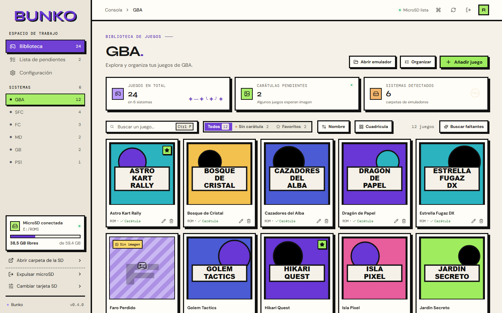

<p align="center">
  
</p>

<p align="center">
  <strong>Tu colección de la R36S, en orden.</strong><br />
  Organiza juegos, carátulas y pendientes de tu microSD desde el escritorio.
</p>

<p align="center">
  <a href="https://github.com/OscarP29/Bunko-R36S/releases/latest"></a>
  <a href="https://github.com/OscarP29/Bunko-R36S/actions/workflows/ci.yml"></a>
  
  
</p>

---

**Bunko** es una aplicación de escritorio para administrar la tarjeta microSD de una consola **R36S** o sus clones. Conectas la tarjeta, eliges la carpeta de ROMs y tienes toda tu biblioteca a la vista: carátulas, orden de la lista, partidas guardadas y hasta los sonidos y fondos de la consola.

<p align="center">
  
</p>

## Funciones

### 🎮 Biblioteca
- Detecta los sistemas de la tarjeta por su `filelist.csv` y reconoce los nombres de carpeta de CubeGM (`FC`, `SFC`, `MD`, `GG`, `NGPC`, `SWC`…).
- Búsqueda, filtros (sin carátula, favoritos), orden y vistas de cuadrícula o lista.
- Añade varias ROMs de una vez. Los `.7z` y los `.zip` de GBA y NES se pueden extraer al copiar.
- Renombra juegos, cambia su carátula o quítalos del catálogo sin borrar la ROM, desde el menú contextual de cada juego.
- **Organiza** el orden de `filelist.csv`, que es el que sigue la consola: alfabético o agrupado por sagas.
- Muestra el espacio libre de la microSD.

### 🖼️ Carátulas
- Busca automáticamente en [Libretro Thumbnails](https://github.com/libretro-thumbnails/libretro-thumbnails).
- Encuentra todas las faltantes de un sistema, o las de todos los juegos que vas a añadir, en un solo clic.
- También puedes subir tus propias imágenes: se convierten a PNG de 512 × 512.

### 💾 Partidas y favoritos (R36SX con CubeGM)
- Muestra con una estrella los juegos que marcaste como favoritos en la consola.
- Copia tus partidas guardadas y rápidas al PC, restáuralas en la misma tarjeta y mueve al PC las de juegos que ya no están.
- Cada tarjeta lleva su propia ficha, así que las copias de varias consolas no se mezclan.

### 🎨 Personaliza la consola (R36SX con CubeGM)
- Cambia la música de fondo y los efectos de sonido.
- Cambia los fondos de los menús y sistemas, la pantalla de carga, la lista de juegos, el buscador, el menú de pausa y los logos de arranque y apagado.
- Antes del primer cambio se guarda el original, y puedes restaurarlo cuando quieras.

### 📝 Lista de pendientes
- Anota juegos por categoría, consola y prioridad, con autocompletado del título, y márcalos al conseguirlos.
- Vacía la lista de una vez, con unos segundos para deshacerlo.
- Genera un prompt con tu biblioteca para que una IA te recomiende juegos, e importa el resultado.
- La lista se guarda en la propia tarjeta, así que viaja con ella.

### ⚡ Comodidad
- **Tema claro, oscuro o del sistema**, y cuatro tamaños de letra.
- **Paleta de comandos** con `Ctrl K` para hacerlo todo desde el teclado.

| Atajo | Acción |
|---|---|
| `Ctrl K` | Abrir comandos |
| `Ctrl 1` `Ctrl 2` `Ctrl 3` | Biblioteca, Pendientes y Configuración |
| `Ctrl F` | Buscar en la página |
| `Ctrl N` | Añadir juegos |
| `Ctrl R` | Volver a escanear |
| `Ctrl +` `Ctrl -` | Cambiar el tamaño de letra |

## Instalación

Descarga el instalador de Windows desde [**Releases**](https://github.com/OscarP29/Bunko-R36S/releases/latest).

> [!NOTE]
> El instalador no está firmado, así que Windows SmartScreen puede mostrar un aviso. Elige **Más información → Ejecutar de todas formas**.

## Cómo se usa

1. Conecta la microSD de tu R36S al equipo.
2. Abre Bunko y elige la carpeta de ROMs de la tarjeta.
3. Bunko detecta los sistemas que tengan un `filelist.csv`. Si una ROM no está en ese archivo, Bunko no la ve.
4. En **Configuración → Consola** elige el modelo de tu consola para activar partidas, favoritos y personalización.
5. Cuando termines, usa **Expulsar microSD** antes de retirar la tarjeta.

> [!IMPORTANT]
> Bunko escribe en tu tarjeta: guarda copias de `filelist.csv` antes de modificarlo y escribe de forma atómica, pero conviene tener una copia de seguridad de la microSD.

## Desarrollo

Necesitas [Node.js](https://nodejs.org/) 22 o superior, [Rust](https://rustup.rs/) estable y los [requisitos de Tauri](https://tauri.app/start/prerequisites/) para Windows.

```bash
npm install
```

```bash
npm run tauri dev
```

| Comando | Qué hace |
|---|---|
| `npm run tauri dev` | Abre la app en modo desarrollo |
| `npm run tauri build` | Genera los instaladores |
| `npm test` | Ejecuta los tests de TypeScript y Rust |
| `npm run typecheck` | Comprueba los tipos |

### Publicar una versión

1. Sube la versión en `package.json`, `src-tauri/tauri.conf.json`, `src-tauri/Cargo.toml` y el pie de la barra lateral (`src/components/Sidebar.tsx`).
2. Crea y sube una etiqueta:

```bash
git tag v0.4.0
```

```bash
git push origin v0.4.0
```

GitHub Actions compila los instaladores y deja un **borrador** en Releases para revisarlo y publicarlo.

### Documentación

- [`docs/CONTEXTO.md`](docs/CONTEXTO.md): arquitectura, decisiones técnicas y detalles internos.
- [`DESIGN.md`](DESIGN.md): sistema de diseño. Es lectura obligatoria antes de tocar la interfaz.

## Tecnología

[Tauri 2](https://tauri.app/) · [Rust](https://www.rust-lang.org/) · [React 18](https://react.dev/) · [TypeScript](https://www.typescriptlang.org/) · [Vite](https://vite.dev/)

## Aviso legal

Bunko no incluye ROMs, BIOS ni juegos, ni ayuda a conseguirlos. Usa solo copias que tengas derecho a utilizar. Las carátulas proceden del proyecto comunitario Libretro Thumbnails. Bunko es un proyecto independiente, sin relación con el fabricante de la R36S.
